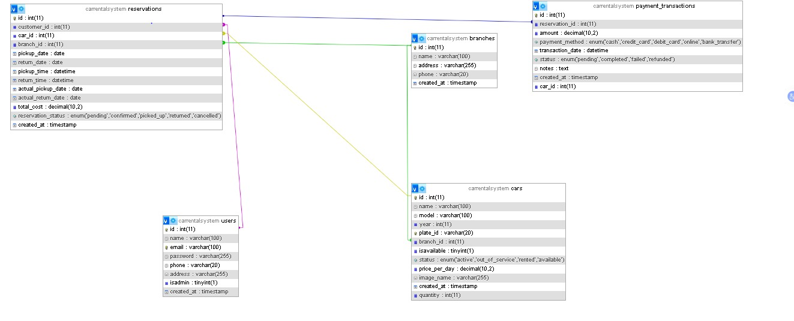

<div align="center">

# 🚗 Car Rental Management System

**A web-based vehicle rental platform built with PHP and MySQL.**

Browse available cars, create reservations, view invoices, record demo payments, and manage rental operations from an admin dashboard.


</div>

## Overview

Car Rental Management System is a **PHP + MySQL portfolio project** demonstrating a multi-branch rental workflow, from customer registration and vehicle discovery to reservations, invoices, payment records, and administrative reporting.

The project runs locally with Apache and MySQL (for example, through XAMPP). **No publicly hosted demo is provided.**

## Features

| Customer experience | Administration |
| --- | --- |
| Register, sign in, and sign out | Manage cars, prices, status, and images |
| Browse available cars and daily rental rates | Assign cars to branches |
| Search by car name/model and filter by branch | View and manage customer accounts |
| Use advanced filters for branch, year, price, and model | Manage pickup and return statuses |
| Reserve vehicles for selected rental periods | Review reservations and payment records |
| View reservation invoices | Run four administrative reports |
| Access a demo payment form | Monitor availability and fleet operations |

### Reporting

The admin reporting page (`admin/advanced_reports.php`) includes:

1. Reservations by date range
2. Vehicle status listing
3. Reservations for a selected customer
4. Daily payment summaries

> **Reporting note:** The vehicle-status page accepts a date, but its current query displays stored vehicle statuses; it is **not** a historical point-in-time status reconstruction.

## Tech Stack

| Layer | Technologies |
| --- | --- |
| Backend | PHP |
| Database | MySQL, MySQLi |
| Frontend | HTML, CSS, JavaScript |
| Local server | Apache via XAMPP |
| Database setup | SQL schema and demo seed data in `database/schema_and_seed.sql` |

## Getting Started

### Prerequisites

- PHP with the MySQLi extension
- Apache web server
- MySQL
- XAMPP (recommended for local setup) or an equivalent PHP/MySQL environment

### 1. Clone the repository

```bash
git clone https://github.com/Muhammadelzmrany/Car-Rental-Management-System.git
```

Place the cloned folder in your Apache document root, typically `C:\xampp\htdocs\` on Windows when using XAMPP.

### 2. Start Apache and MySQL

Open the XAMPP Control Panel and start **Apache** and **MySQL**.

### 3. Create and import the database

Open `http://localhost/phpmyadmin`, create a database named `carrentalsystem`, and import the repository's `database/schema_and_seed.sql` file into that database.

Alternatively, run:

```sql
CREATE DATABASE carrentalsystem;
```

Then import `database/schema_and_seed.sql` using your preferred MySQL tool. The script creates the tables and inserts demo data.

### 4. Configure the database connection

Database settings are read from **environment variables**, an ignored `config.local.php` file, or safe XAMPP demo defaults. Never edit or commit credentials inside `includes/config.php`.

For local development, copy `config.local.php.example` to `config.local.php` in the project root and adjust the database credentials:

```php
<?php
define('DB_HOST', 'localhost');
define('DB_USER', 'root');
define('DB_PASS', ''); // Enter your local database password if set.
define('DB_NAME', 'carrentalsystem');
```

`config.local.php` is ignored by Git. Environment variables `DB_HOST`, `DB_USER`, `DB_PASS`, and `DB_NAME` are also supported when there is no local override. Do not upload `config.local.php` to a publicly readable document root without proper server-side PHP configuration. **If any past credentials were committed, rotate them — deleting them from the latest commit does not erase Git history.**

For public demo deployment and hosting limitations, see [Free Hosting Guide](docs/HOSTING.md).

### 5. Run the app

Open:

**http://localhost/Car-Rental-Management-System/**

## Demo Accounts

The imported SQL file includes sample accounts intended **only for local testing**.

| Role | Email | Password |
| --- | --- | --- |
| Admin | `admin@carrental.com` | `admin123` |
| Customer | `ahmed@test.com` | `test123456` |
| Customer | `sara@test.com` | `test123456` |
| Customer | `mohamed@test.com` | `test123456` |

> These are public test credentials in the seed dataset. Replace them before any deployment and never use them for real accounts.

## Example Workflow

**Customer:** Browse cars → choose a car → enter rental dates/duration → confirm reservation → view invoice → continue to demo payment.

**Admin:** Sign in as an administrator → manage vehicles and users → update pickup/return status → view reports.

## Database Design

The MySQL schema in `database/schema_and_seed.sql` contains five core tables:

- `branches` — rental office details
- `users` — customer and admin accounts
- `cars` — vehicle inventory, rates, and branch assignments
- `reservations` — bookings, rental dates, and statuses
- `payment_transactions` — payment amounts, methods, and statuses

The schema uses primary keys, foreign keys, and uniqueness constraints to maintain relationships between records.



## Project Structure

```text
Car-Rental-Management-System/
├── .github/                # GitHub configuration and workflows
├── admin/                  # Admin dashboard and operations
├── php/                    # Login, rental, search, payment, invoices
├── includes/               # Configuration, database and helpers
├── css/                    # Stylesheets
├── js/                     # Client-side scripts
├── html/                   # Additional HTML pages
├── img/                    # Application images and media
├── uploads/                # Vehicle images and uploaded files
├── database/
│   └── schema_and_seed.sql # MySQL tables and example data
├── docs/
│   ├── README.md           # Documentation index
│   ├── assets/             # ERD diagram
│   ├── audits/             # Requirements and implementation audits
│   └── maintenance/        # CSS and image maintenance notes
├── config.local.php.example
├── start.bat               # Local XAMPP startup helper (Windows)
├── index.php               # Application entry point
└── README.md               # Project overview and setup guide
```

## Important Notes

- **Portfolio/demo project:** It is intended to demonstrate application structure and rental-management workflows, not production readiness.
- **Payments:** The payment page validates form fields and records transactions in the application's database. **It is not connected to a verified external payment gateway. Do not enter real card details.**
- **Security:** The code contains security measures such as password hashing, CSRF tokens, and prepared statements in various flows, but this README does not claim a completed security assessment.
- **Deployment:** Before hosting publicly, review configuration handling, replace sample accounts, assess payment security, and perform end-to-end testing.

## Further Documentation

- [Documentation index](docs/README.md)
- [Free PHP + MySQL hosting guide](docs/HOSTING.md)

- [Implementation audit notes](docs/audits/AUDIT_REPORT.md)
- [Requirements and development notes](docs/audits/PROJECT_REQUIREMENTS_COMPLIANCE.md)
- [CSS fixes summary](docs/maintenance/CSS_FIXES_SUMMARY.md)

*Some development notes describe earlier project states; the source code is the reference for current behavior.*

## Possible Next Improvements

- Add real application screenshots and a short walkthrough GIF
- Integrate a certified payment provider instead of the demo form
- Add automated tests and a reproducible deployment guide
- Move configuration values out of committed source files

---

<div align="center">

**Built as a hands-on PHP & MySQL database-driven web application.**

</div>
